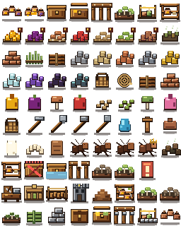

# ANT FARM colony texture pack

> Build I · one deterministic, transparent, nearest-neighbour atlas for every current colony-made object, physical storage overflow, crops, carried loads and reusable future variants.



## Runtime contract

- Production image: `assets/textures/colony-atlas.png` (`256 × 320`, 80 transparent `32 × 32` cells).
- Machine-readable manifest: `assets/textures/colony-atlas.json`.
- Browser manifest: `assets/textures/colony-atlas.manifest.js` (same data, loaded synchronously without `fetch`).
- Canvas loader: `js/texture-pack.js`; it forces nearest-neighbour rendering and safely returns `false` until the PNG is ready.
- Reproducible source: `scripts/generate-colony-atlas.py`.

No gameplay code may hard-code atlas coordinates. Draw by stable name:

```js
if (!colonyTexturePack.draw(ctx, 'project.clay_jars', x, y, 30, 30)) {
  drawClayJarFallback(ctx, x, y);
}

colonyTexturePack.drawAt(ctx, 'cargo.clay_brick', worldX, worldY, 0.35);
```

`draw()` receives a destination rectangle. `drawAt()` uses the manifest pivot and native dimensions. Both return a boolean so Canvas primitives can remain as a loading/error fallback.

Stateful and future families use ordered name lookup rather than new coordinate code:

```js
colonyTexturePack.drawFirst(ctx,
  ['project.forward_cache_full', 'project.forward_cache'], x, y, w, h);
colonyTexturePack.drawVariant(ctx, 'project.tunnel_braces', 'reinforced', x, y, w, h);
```

`resolve()`, `drawFirst()` and `drawVariant()` always choose the first manifest key that exists. A future `<base>_<variant>` tile can therefore be appended without breaking older sheets or save data; the stable base is the fallback.

## Adding a texture

1. Add one `SpriteSpec` to `SPECS` in `scripts/generate-colony-atlas.py` and draw only inside its `32 × 32` transparent tile.
2. Use a namespaced stable key (`project.*`, `overflow.*`, `material.*`, and so on). Existing keys are save/API contracts and must not be renamed casually.
3. Run `python3 scripts/generate-colony-atlas.py` from the game directory.
4. Run `node ../test/texture-pack.js`; it verifies PNG dimensions, unique/in-bounds rectangles, pivots, parity between JSON and JS, and required gameplay sprites.
5. Call the key from Canvas code and keep a primitive fallback for the image-loading frame.

## Catalog

### PROJECTS

| Stable name | Rect | Pivot | Purpose |
|---|---:|---:|---|
| `project.clay_jars` | `0,0 32×32` | `16,27` | Three sealed clay vessels at the nest store. |
| `project.clay_jars_full` | `32,0 32×32` | `16,27` | Filled jar variant for high protected reserve. |
| `project.forward_cache` | `64,0 32×32` | `16,27` | Closed operational forward cache. |
| `project.forward_cache_open` | `96,0 32×32` | `16,27` | Cache being loaded or unloaded. |
| `project.tunnel_braces` | `128,0 32×32` | `16,27` | Three-frame timber tunnel support. |
| `project.fungus_bed` | `160,0 32×32` | `16,27` | Tended fungus-growing bed. |
| `project.worksite` | `192,0 32×32` | `16,27` | Survey stakes and delivered construction bundles. |
| `project.store_shelf` | `224,0 32×32` | `16,27` | Founding-store shelving module. |

### OVERFLOW

| Stable name | Rect | Pivot | Purpose |
|---|---:|---:|---|
| `overflow.honey` | `0,32 32×32` | `16,27` | Unprotected honey on a reed mat. |
| `overflow.berry` | `32,32 32×32` | `16,27` | Unprotected berry pile. |
| `overflow.mushroom` | `64,32 32×32` | `16,27` | Unprotected fungus pile. |
| `overflow.apple` | `96,32 32×32` | `16,27` | Unprotected apple pile. |
| `overflow.seed` | `128,32 32×32` | `16,27` | Dry unprotected seeds. |
| `overflow.grain` | `160,32 32×32` | `16,27` | Dry unprotected grain. |
| `overflow.mixed` | `192,32 32×32` | `16,27` | Legacy mixed ration pile. |
| `overflow.spoilage` | `224,32 32×32` | `16,27` | Fully spoiled overflow/waste transition. |

### MATERIALS

| Stable name | Rect | Pivot | Purpose |
|---|---:|---:|---|
| `material.clay` | `0,64 32×32` | `16,27` |  |
| `material.fiber` | `32,64 32×32` | `16,27` |  |
| `material.wood` | `64,64 32×32` | `16,27` |  |
| `material.stone` | `96,64 32×32` | `16,27` |  |
| `material.sand` | `128,64 32×32` | `16,27` |  |
| `material.copper` | `160,64 32×32` | `16,27` |  |
| `material.iron` | `192,64 32×32` | `16,27` |  |
| `material.gold` | `224,64 32×32` | `16,27` |  |
| `material.quartz` | `0,96 32×32` | `16,27` |  |
| `material.gem` | `32,96 32×32` | `16,27` |  |
| `material.obsidian` | `64,96 32×32` | `16,27` |  |
| `material.meteorite` | `96,96 32×32` | `16,27` |  |

### CARGO

| Stable name | Rect | Pivot | Purpose |
|---|---:|---:|---|
| `cargo.basket` | `128,96 32×32` | `16,27` |  |
| `cargo.rope` | `160,96 32×32` | `16,27` |  |
| `cargo.beam` | `192,96 32×32` | `16,27` |  |
| `cargo.clay_brick` | `224,96 32×32` | `16,27` |  |

### FOOD

| Stable name | Rect | Pivot | Purpose |
|---|---:|---:|---|
| `food.honey` | `0,128 32×32` | `16,27` |  |
| `food.berry` | `32,128 32×32` | `16,27` |  |
| `food.mushroom` | `64,128 32×32` | `16,27` |  |
| `food.apple` | `96,128 32×32` | `16,27` |  |
| `food.seed` | `128,128 32×32` | `16,27` |  |
| `food.grain` | `160,128 32×32` | `16,27` |  |
| `food.fungus_chunk` | `192,128 32×32` | `16,27` |  |
| `food.nectar` | `224,128 32×32` | `16,27` |  |

### TOOLS

| Stable name | Rect | Pivot | Purpose |
|---|---:|---:|---|
| `tool.basket` | `0,160 32×32` | `16,27` |  |
| `tool.pick` | `32,160 32×32` | `16,27` |  |
| `tool.trowel` | `64,160 32×32` | `16,27` |  |
| `tool.hammer` | `96,160 32×32` | `16,27` |  |
| `tool.shovel` | `128,160 32×32` | `16,27` |  |
| `utility.water` | `160,160 32×32` | `16,27` |  |
| `utility.brace_peg` | `192,160 32×32` | `16,27` |  |
| `utility.jar_lid` | `224,160 32×32` | `16,27` |  |

### COLONY

| Stable name | Rect | Pivot | Purpose |
|---|---:|---:|---|
| `brood.egg` | `0,192 32×32` | `16,27` |  |
| `brood.larva` | `32,192 32×32` | `16,27` |  |
| `brood.pupa` | `64,192 32×32` | `16,27` |  |
| `ant.worker` | `96,192 32×32` | `16,27` |  |
| `ant.minim` | `128,192 32×32` | `16,27` |  |
| `ant.major` | `160,192 32×32` | `16,27` |  |
| `ant.queen` | `192,192 32×32` | `16,27` |  |
| `colony.waste` | `224,192 32×32` | `16,27` |  |

### STATES

| Stable name | Rect | Pivot | Purpose |
|---|---:|---:|---|
| `structure.store` | `0,224 32×32` | `16,27` |  |
| `state.cache_disabled` | `32,224 32×32` | `16,27` |  |
| `state.cache_flooded` | `64,224 32×32` | `16,27` |  |
| `state.brace_damaged` | `96,224 32×32` | `16,27` |  |
| `state.fungus_dry` | `128,224 32×32` | `16,27` |  |
| `state.fungus_healthy` | `160,224 32×32` | `16,27` |  |
| `state.storage_pressure` | `192,224 32×32` | `16,27` |  |
| `state.reserved` | `224,224 32×32` | `16,27` | Reserved transparent slot for a compatible future sprite. |

### STRUCTURES AND CULTIVATION (BUILD I)

| Stable name | Rect | Purpose |
|---|---:|---|
| `structure.workshop` | `0,256 32×32` | Ant-built timber workbench and tools. |
| `structure.granary` | `32,256 32×32` | Dry three-bin granary. |
| `structure.bridge` | `64,256 32×32` | Rope-bound timber bridge. |
| `structure.tower` | `96,256 32×32` | Worked-stone lookout. |
| `structure.mound` | `128,256 32×32` | Excavated spoil mound and supported entrance. |
| `structure.store_full` | `160,256 32×32` | Stocked protected shelf variant. |
| `crop.fungus_bed` | `192,256 32×32` | Healthy cultivated bed. |
| `crop.fungus_dry` | `224,256 32×32` | Dry cultivated bed. |
| `crop.fungus_seedling` | `0,288 32×32` | Newly established fungus plugs. |

### CARRIED LOADS AND PROJECT VARIANTS (BUILD I)

| Stable name | Rect | Purpose |
|---|---:|---|
| `cargo.fiber_bundle` | `32,288 32×32` | Bound fibre construction load. |
| `cargo.stone_block` | `64,288 32×32` | Worked stone load. |
| `cargo.supply_crate` | `96,288 32×32` | Generic reusable construction fallback. |
| `project.forward_cache_full` | `128,288 32×32` | Cache with visible protected stock. |
| `project.tunnel_braces_reinforced` | `160,288 32×32` | Timber support with metal joints. |
| `project.worksite_foundation` | `192,288 32×32` | Worksite after first deliveries. |
| `project.clay_jars_empty` | `224,288 32×32` | Empty sealed-vessel state. |

Current render paths use the sheet for completed projects, all legacy built structures, autonomous fungus crops, equipped tools, carried food/project loads and spoil mounds. Primitive renderers remain only as the one-frame loading/error fallback.

## Rendering rules

- Keep `imageSmoothingEnabled = false`; integer destination edges are preferred.
- The transparent tile boundary is padding, not part of the sprite.
- Upper-left faces are lighter and lower-right faces are darker, matching the game’s voxel earth.
- Storage overflow uses reed mats plus a warning peg. It must never reuse the green protected-stock marker.
- State variants (`disabled`, `flooded`, `dry`, `damaged`) describe physical conditions; do not replace them with floating UI labels.
- The atlas is for render assets only. Capacity, spoilage and connectivity remain simulation state.
